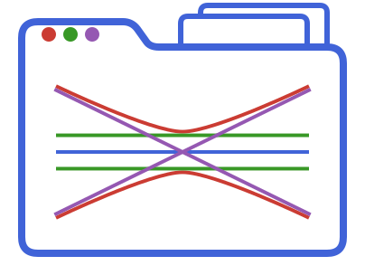

<div align="center">
  
</div>

# BeamletOpticsProjects.jl

[](https://github.com/StackEnjoyer/BeamletOpticsProjects.jl/actions/workflows/CI.yml?query=branch%3Amain)

Projects of [BeamletOptics.jl](https://github.com/JuliaPhysics/BeamletOptics.jl): an optical
setup saved as a folder that people open in
[BeamletOpticsGUI.jl](https://github.com/StackEnjoyer/BeamletOpticsGUI.jl) and that coding agents
edit at the same time. A project pins the versions of the packages it was made with, so it opens
as it was, also years later.

> [!NOTE]
> A prototype, not registered yet. The format of the files may still change.

## A project

```text
Bench/
├── Bench.bmo           the project file, which people open
├── system.jl           the setup: one line per component, source and system
├── src/Bench.jl        own code of the project (functions, components)
├── Project.toml        the exact versions of BeamletOptics and its packages
├── view.toml           how the GUI shows it (camera, layout)
├── AGENTS.md           instructions for coding agents (CLAUDE.md points to it)
└── .bmo/               written by the open GUI, e.g. session-<person>.md (not versioned)
```

`system.jl` is plain Julia, readable and writable by people and agents:

```julia
@component L1 = SphericalLens(0.05, -0.05, 0.005, 0.0254, 1.5) pos = (0.0, 0.1, 0.0) label = "Collimator" uid = "…"
@component D1 = Detector(0.02) pos = (0.0, 0.3, 0.0) uid = "…"
@source B1 = Beam([0.0, 0.0, 0.0], [0.0, 1.0, 0.0], 1.0e-6) uid = "…"
@system S1 = [L1, D1] sources = [B1] uid = "…"
```

`L1` is the readable id, `label` the name people see, `uid` the machine id that the GUI keeps
across renames.

## Use

```julia
using BeamletOptics, BeamletOpticsProjects

p = new_project("Bench")        # the folder, its files and the first version
p = load_project("Bench")       # or "Bench/Bench.bmo"
p[:L1]                          # the objects, by id
save_project(p)                 # writes system.jl; throws ProjectChanged if the files changed meanwhile
save_version("Bench")           # a version (a git commit via libgit2, no git install needed)
versions("Bench")
```

In the GUI, `open_project("Bench/Bench.bmo")` opens it; the window saves every action to the files
and merges what an agent changes, live.
